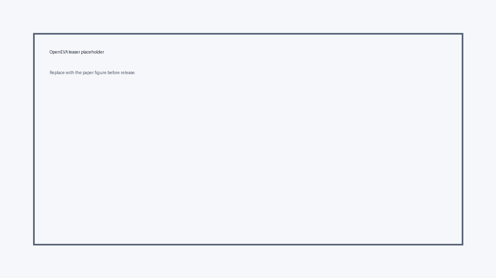

# OpenEVA

OpenEVA is the inference-only release workspace for EVA01-Instruct, a 3D understanding model for mesh and point-cloud conditioned captioning and chat.



This repository contains the public inference and evaluation code for:

- Point cloud and mesh captioning.
- Mesh-conditioned chat.
- Terminal single-turn inference.
- Terminal multi-turn chat.
- Gradio multi-turn chat with interactive mesh preview.
- PointLLM-200 caption evaluation.
- Caption metrics and optional GPT judging.
- Render-based GPT judge from user-provided render manifests.

It does not contain training code, training configs, experiment logs, private data paths, or model weights.

## Checkpoints

Two checkpoint variants are supported.

`OpenEVA-Instruct-LoRA` is the default variant. It is distributed as a self-contained bundle with the base language model weights, tokenizer files, point backbone weights, connector weights, and LoRA adapter weights. Users do not need to download Qwen3-VL separately, but the runtime still loads the LoRA adapter.

`OpenEVA-Instruct-Full` is the full-weight variant. It does not load a LoRA adapter at runtime.

The Hugging Face links are placeholders for this release draft:

- `YOUR_ORG/OpenEVA-Instruct-LoRA`
- `YOUR_ORG/OpenEVA-Instruct-Full`

Expected local paths:

```bash
checkpoints/openeva-instruct-lora
checkpoints/openeva-instruct-full
```

After the public model repositories are available, update the placeholder repo IDs and run:

```bash
python scripts/download_checkpoints.py --variant lora
python scripts/download_checkpoints.py --variant full
```

## Install

Create an environment with a CUDA-enabled PyTorch build, then install the curated requirements:

```bash
pip install -r requirements.txt
```

For optional GPT metrics, set:

```bash
cp .env.example .env
export OPENAI_WIRE_API=responses
```

Set `OPENAI_API_KEY` in your shell or `.env` file when you run optional GPT metrics. `OPENAI_BASE_URL` can be left empty for the official OpenAI API, or set to an OpenAI-compatible endpoint.

## Quick Inference

Single-turn mesh captioning:

```bash
python scripts/infer_mesh.py \
  --checkpoint checkpoints/openeva-instruct-lora \
  --mesh examples/meshes/Dwarf.glb
```

Ask a specific question:

```bash
python scripts/infer_mesh.py \
  --checkpoint checkpoints/openeva-instruct-lora \
  --mesh examples/meshes/RV.glb \
  --question "Describe the visible geometry, color, and likely function."
```

Run the full-weight variant:

```bash
python scripts/infer_mesh.py \
  --checkpoint checkpoints/openeva-instruct-full \
  --mesh examples/meshes/Dwarf.glb
```

Supported inputs are `.glb`, `.gltf`, `.obj`, `.ply`, `.stl`, `.npy`, and `.npz`. Meshes are sampled to `8192` `xyzrgb` points by default. The sampler uses UV texture colors when available, then face colors, then vertex colors, then neutral gray fallback.

## Terminal Chat

```bash
python scripts/chat_mesh_cli.py \
  --checkpoint checkpoints/openeva-instruct-lora \
  --mesh examples/meshes/Dwarf.glb
```

Commands:

- `/load PATH`
- `/reset`
- `/history`
- `/save PATH`
- `/exit`

The loaded mesh stays fixed across turns. The prompt has no system message by default.

## Gradio Chat

```bash
python scripts/app_gradio.py \
  --checkpoint checkpoints/openeva-instruct-lora \
  --host 127.0.0.1 \
  --port 7860
```

The UI includes an interactive mesh preview and a multi-turn chat panel.

## PointLLM-200 Evaluation

Prepare the local layout:

```bash
python scripts/prepare_pointllm200.py --data-root data/pointllm200
```

Place the official PointLLM-200 annotation file and extracted `8192` point clouds in:

```text
data/pointllm200/annotations/PointLLM_brief_description_val_200_GT.json
data/pointllm200/pointclouds/8192_npy/<object_id>_8192.npy
```

Run caption generation:

```bash
python scripts/eval_pointllm200_caption.py \
  --checkpoint checkpoints/openeva-instruct-lora \
  --eval-annotation-path data/pointllm200/annotations/PointLLM_brief_description_val_200_GT.json \
  --pointcloud-dir data/pointllm200/pointclouds/8192_npy \
  --output-dir outputs/pointllm200_lora
```

Run the overlap metrics:

```bash
python scripts/score_caption_metrics.py \
  --results-path outputs/pointllm200_lora/objaverse_captioning_prompt2_predictions.json \
  --output-path outputs/pointllm200_lora/objaverse_captioning_prompt2_metrics.json \
  --enable-meteor
```

Optional embedding and GPT metrics:

```bash
python scripts/score_caption_metrics.py \
  --results-path outputs/pointllm200_lora/objaverse_captioning_prompt2_predictions.json \
  --output-path outputs/pointllm200_lora/objaverse_captioning_prompt2_metrics_full.json \
  --enable-meteor \
  --enable-sentence-bert \
  --enable-simcse \
  --enable-gpt-average-score \
  --gpt-model-name gpt-5.5
```

The metric JSON contains `overall_scores`, `results`, `metadata`, and `unavailable_metrics`.

## Render-Based GPT Judge

This repository does not render images. Provide a manifest with existing render paths:

```json
[
  {
    "object_id": "sample_001",
    "caption": "model prediction",
    "renders": {
      "front": "path/to/front.png",
      "right": "path/to/right.png",
      "back": "path/to/back.png",
      "left": "path/to/left.png"
    }
  }
]
```

Run:

```bash
python scripts/score_render_gpt_judge.py \
  --manifest render_manifest.json \
  --output-path outputs/render_gpt_judge.json \
  --judge-model gpt-5.5
```

## Citation

```bibtex
@misc{yang2026eva01unifiednative3d,
  title         = {EVA01: Unified Native 3D Understanding and Generation via Mixture-of-Transformers},
  author        = {Zongyuan Yang and Mingjing Yi and Wanli Ma and Chenzhuo Fan and Bocheng Li and Baolin Liu and Yuke Lou and Yingde Song and Yongping Xiong and Zhengdong Guo and Shimu Wang},
  year          = {2026},
  eprint        = {2605.16745},
  archivePrefix = {arXiv},
  primaryClass  = {cs.CV},
  url           = {https://arxiv.org/abs/2605.16745}
}
```

## Acknowledgements

OpenEVA builds on ideas and components from PointLLM, Trellis.2, Qwen3-VL, and Objaverse.
