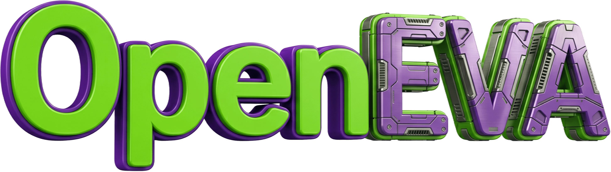

# OpenEVA

<p align="center">
  <a href="https://github.com/SeeleAI/OpenEVA"></a>
  <a href="https://github.com/SeeleAI"></a>
  <a href="https://huggingface.co/SEELE-AI"></a>
  <a href="https://www.seeles.ai/research/pages/EVA01"></a>
  <a href="https://arxiv.org/abs/2605.16745"></a>
  <a href="https://x.com/SEELE_AI1125"></a>
  <a href="https://www.linkedin.com/company/seeleai"></a>
</p>

<div align="center">
  
  <br>
  
</div>

OpenEVA is the community release hub for SEELE-AI's EVA series: native 3D foundation models for mesh understanding, generation, and long-context editing.

## 🗞️ News

- 🟢 **2026-06-16** · OpenEVA opens the EVA01 UND-side release path with inference, evaluation, and gallery assets.
- 🟣 **2026-05-16** · The EVA01 technical report appears on arXiv: [2605.16745](https://arxiv.org/abs/2605.16745).

## 🧭 Overview

EVA treats 3D meshes as a first-class multimodal language. The series is designed for models that can read object geometry, reason about appearance and structure, generate 3D shape, and preserve identity through multi-turn 3D editing.

The current public package focuses on **EVA01 UND-side** capabilities. It provides a compact runtime for `.glb` mesh input, reproducible evaluation scripts, example assets, and Hugging Face checkpoint placeholders for the Full and LoRA releases.

## ✨ Highlights

- 🧩 **Native 3D modality**: EVA01 represents mesh input through a dedicated UND encoder and connector rather than through 2D image-only proxies.
- 🚀 **Compact public runtime**: the release keeps inference, evaluation, Gradio chat, and example assets under `EVA01/`.
- 🤗 **Transformers-style API**: public usage follows `from_pretrained`, processor chat templates, and `generate`.
- 📐 **PointLLM-200 evaluation**: deterministic caption metrics and optional GPT-ref / GPT-img judge paths are documented in the EVA01 package.
- 🖼️ **PBR gallery**: 10 local TexVerse examples include real Blender PBR 2x2 GLB renders.

## 📦 Current Releases / Model Zoo

| Model | Status | Checkpoint | Notes |
| --- | --- | --- | --- |
| EVA01-2B-Instruct | 🟢 UND-side Full | [`SEELE-AI/EVA01-2B-Instruct`](https://huggingface.co/SEELE-AI/EVA01-2B-Instruct) | Full checkpoint with EVA01 UND components and Qwen3-VL language backbone. |
| EVA01-2B-Instruct-LoRA | 🟢 UND-side LoRA | [`SEELE-AI/EVA01-2B-Instruct-LoRA`](https://huggingface.co/SEELE-AI/EVA01-2B-Instruct-LoRA) | PEFT adapter release with EVA01 UND components. |
| EVA01 data | 🟣 Planned | TBA | Public data release is planned. |
| EVA02 generation-side release | 🟡 Planned | TBA | Generation-side open-source release is planned for a later EVA02 milestone. |

## ⚡ Quick Start

```bash
cd EVA01
bash install.sh
source .venv/bin/activate
python infer.py --mesh assets/examples/construction_backhoe.glb
```

The full install guide, Python API, Gradio app, evaluation commands, metrics, and gallery live in [EVA01/README.md](EVA01/README.md).

## 📐 Evaluation

EVA01 includes a one-command PointLLM-200 evaluation entrypoint. The deterministic path reports BLEU, ROUGE, METEOR, Sentence-BERT, and SimCSE under fixed seed `20260615`. Optional GPT-ref and GPT-img judge paths are available when API credentials and Blender PBR render assets are provided.

```bash
cd EVA01
python eval_pointllm200.py --variant full
python eval_pointllm200.py --variant lora
```

## 🖼️ Gallery

The EVA01 package includes 10 TexVerse `.glb` examples and matching 2x2 Blender PBR four-view previews. The full table includes Q1/A1, object-specific Q2/A2, and GT captions.

➡️ See the rendered gallery in [EVA01/README.md](EVA01/README.md).

## 🗺️ Roadmap

- 🟣 **Data release**: public data packaging is planned.
- 🟡 **EVA02**: generation-side open-source release is planned for a later milestone.
- 🧪 **Evaluation assets**: benchmark packaging and reproducibility evidence will continue to be consolidated around the public EVA01 flow.

## 📚 Citation

```bibtex
@misc{eva01_2026,
  title  = {EVA01: Unified Native 3D Understanding and Generation via Mixture-of-Transformers},
  author = {Zongyuan Yang and Mingjing Yi and Wanli Ma and Chenzhuo Fan and Bocheng Li and Baolin Liu and Yuke Lou and Yingde Song and Yongping Xiong and Zhengdong Guo and Shimu Wang},
  year   = {2026},
  eprint = {2605.16745},
  archivePrefix = {arXiv},
  primaryClass = {cs.CV}
}
```

## 📄 License

OpenEVA is released under the [Apache-2.0 license](LICENSE).

## 🔗 Contact

- 🌐 Project page: [seeles.ai/research/pages/EVA01](https://www.seeles.ai/research/pages/EVA01)
- 🤗 Hugging Face: [SEELE-AI](https://huggingface.co/SEELE-AI)
- 🧩 GitHub: [SeeleAI](https://github.com/SeeleAI)
- 💬 X: [SEELE_AI1125](https://x.com/SEELE_AI1125)
- 💼 LinkedIn: [SEELE-AI](https://www.linkedin.com/company/seeleai)
